<!-- Profile -->

# Hi, I'm Bakr Bouhaya 👋

### Computer Science student at the University of Illinois Chicago

Software Engineering concentration · GPA 3.61/4.0 · SUCCEEDS Award recipient

I build AI, machine-learning, and iOS products, with a special interest in multilingual NLP and practical applications of generative AI.

<!-- Stats -->

    
  
  

<!-- Experience -->
## 💼 Experience

- **ML Student Developer — AbbVie Tech in Residence** · Built a multi-agent application for R&D teams to synthesize and query reports. Developed a React and Python feedback pipeline with ChromaDB and two Ollama agents, helping users refine reports 5–10× faster. Interviewed 10 Business Technology Solutions employees to inform the product design.
- **Research Assistant — Algoverse** · Developed a reproducible Python pipeline for multilingual riddle generation and evaluation across five languages and three LLMs. Created Adaptive Originality Filtering, reaching Distinct-2 of 0.915 and Self-BLEU of 0.177; the work was accepted at the COLM 2025 Workshop (WMDQS). Built an evaluation suite whose RiddleScore correlated 0.83 with human ratings.
- **NLP Research Intern — UIC** · Reviewed 25+ papers and evaluated 10+ datasets for multilingual and low-resource language research, identifying data gaps in Tamazight and dialectal Arabic.

<!-- Selected Projects -->
## 🚀 Selected Projects

- **Signa** · Built a real-time ASL translator with Apple Vision and Core ML that recognizes 24+ signs using 7-of-10-frame voting. Added bidirectional translation with a SceneKit avatar and an 82-entry gesture lexicon. Selected for the 2026 Code + Create App Accelerator.
- **WiseAI** · Built an iOS app with a Python backend and mood-analysis engine that personalizes quotes from a dataset of 500,000+ entries. Led adaptive mood-detection work that improved accuracy by 15%; showcased at the 2025 Code + Create Competition.
- **Federal Funds Rate Forecasting** · Developed a time-series ML pipeline with CatBoost, XGBoost, and Random Forest. Feature engineering reduced RMSE to 0.7097, 9% below the baseline.

<!-- Education -->
## 🎓 Education

**University of Illinois Chicago** · B.Eng. in Computer Science, Software Engineering concentration · Expected May 2028  
SUCCEEDS Award — $60,000 scholarship

<!-- Tech Stack -->

## 💻 Tech Stack ⚡

      

     

 

**Natural languages:** English · French · Arabic

<!-- Leadership & Involvement -->
## 🌟 Leadership & Involvement

- Selected for the 2026 Y Combinator Startup School conference.
- Led 15 students in designing a nine-module 3D DNA model in Blender, earning top recognition in a regional competition.
- Association for Computing Machinery · Muslim Students Association

<!-- Social connections -->

## 🌐 Connect with Me 🍬

  

<!-- Snake Animation -->

  

<!-- Visit Counter -->

  

